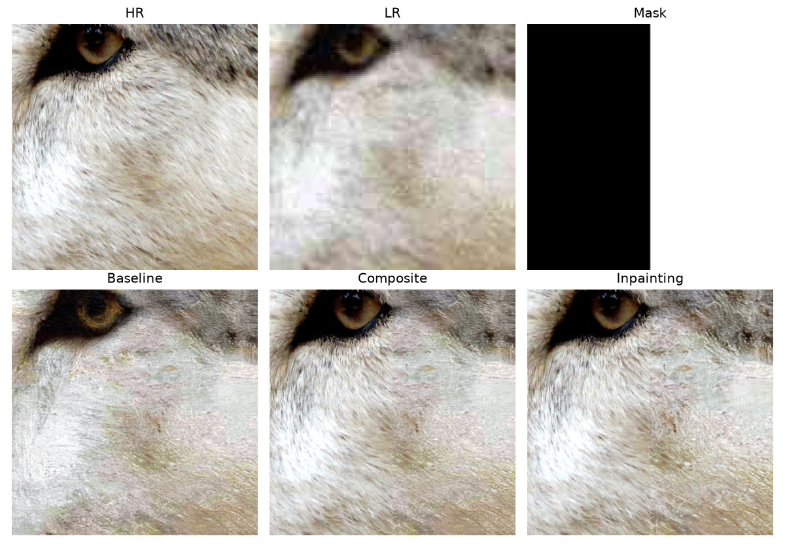
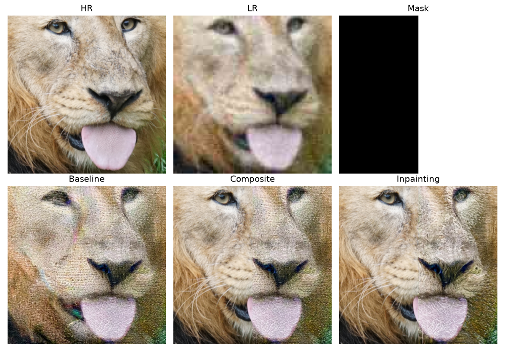
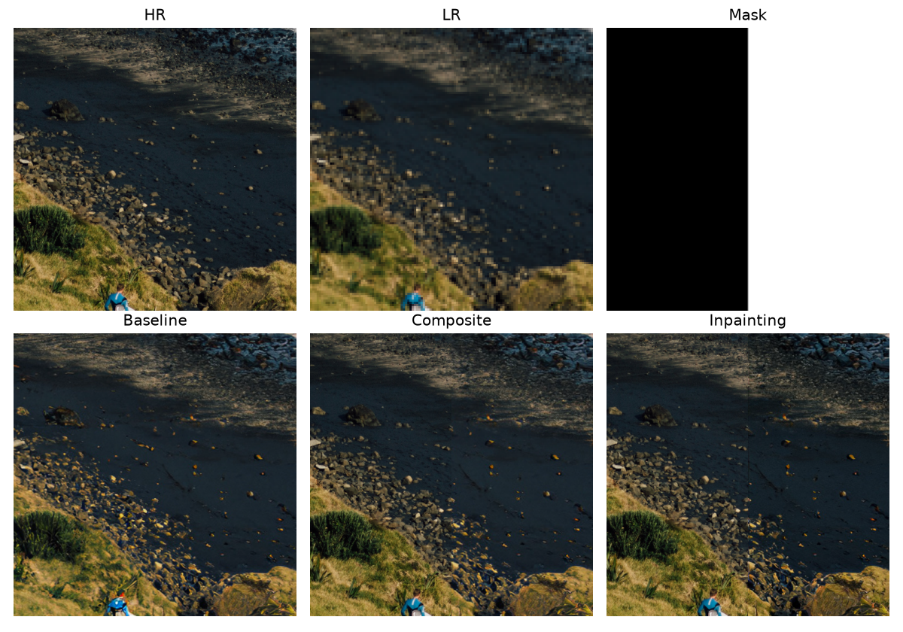
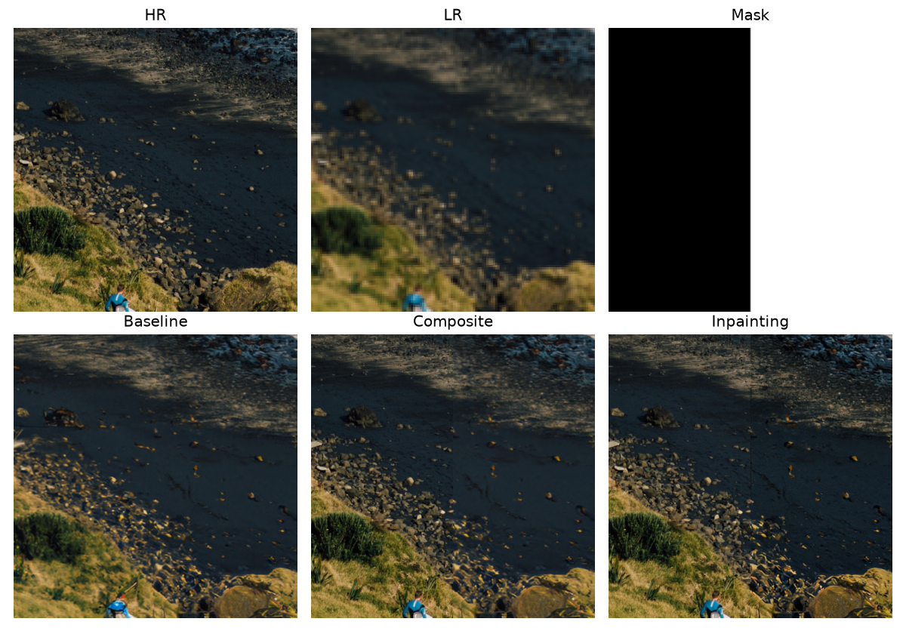
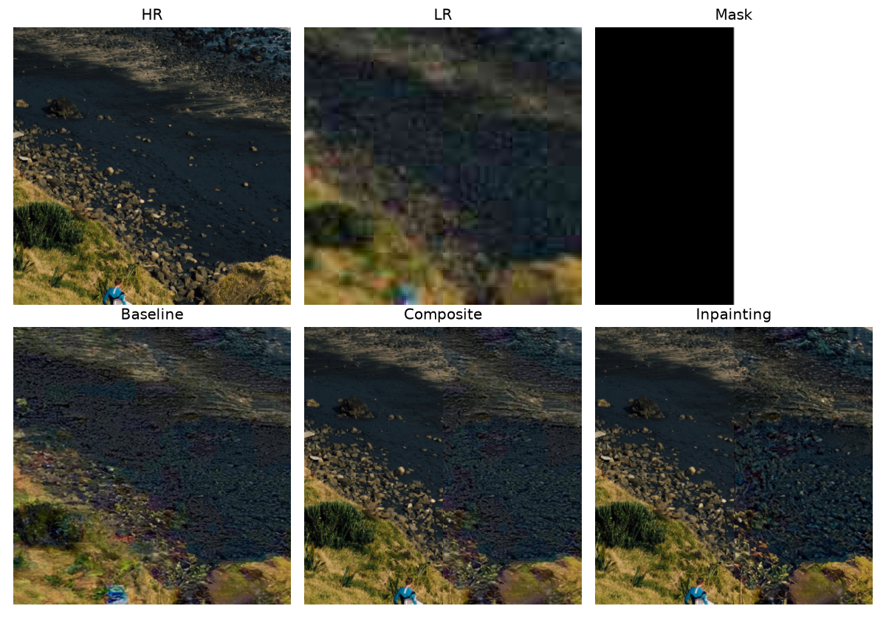
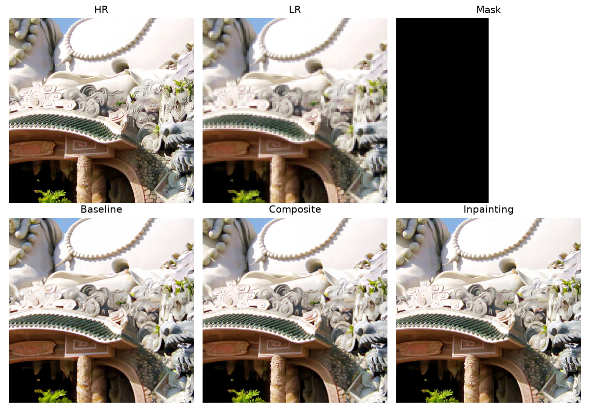
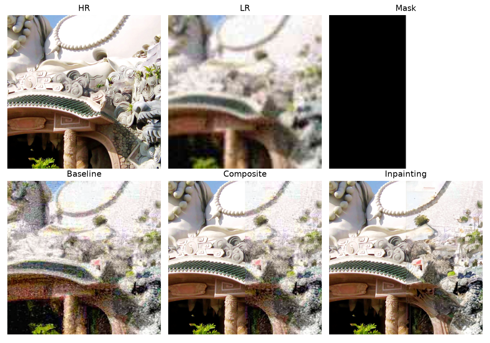
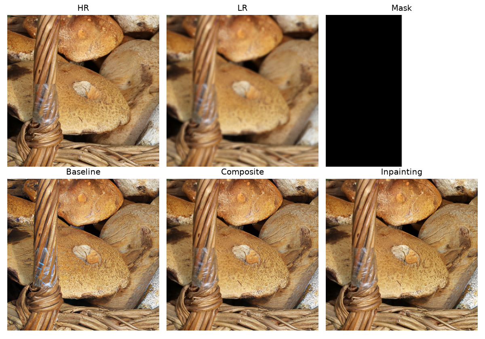
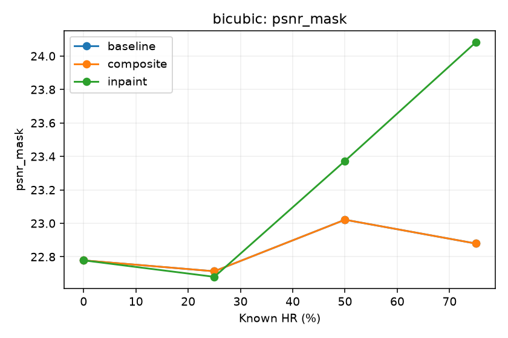
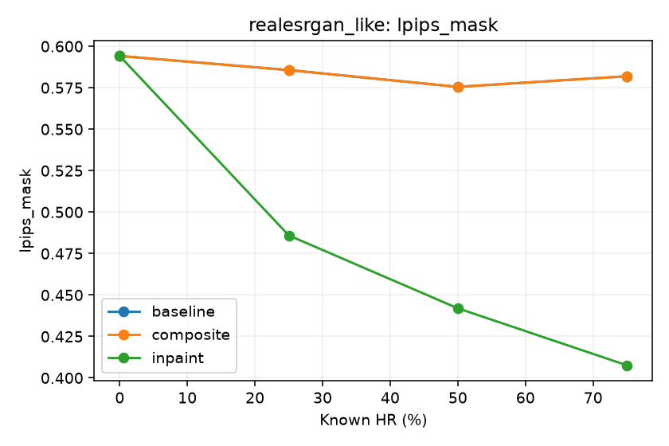

# Лабораторная работа № 3. Сверхразрешение ×4 с восстановлением по маске

## 1. Теоретическая база

### Постановка задачи

Сверхразрешение (SR) восстанавливает изображение высокого разрешения $x$ (HR) по наблюдению низкого разрешения $y$ (LR). При увеличении ×4 изображению $y$ размера $h \times w$ соответствует HR размера $4h \times 4w$. В эксперименте LR моделируется оператором деградации $\mathcal{D}$, который уменьшает изображение и может включать размытие, шум и JPEG-сжатие.

$$
y = \mathcal{D}(x).
$$

Разные HR-изображения могут давать одно и то же LR-наблюдение. Предобученная диффузионная модель позволяет сгенерировать правдоподобный вариант, а известная часть HR даёт дополнительный контекст. Бинарная маска $m$ на сетке LR обозначает область генерации единицами и известную область нулями. Маска $M$ на сетке HR получается повторением каждого значения $m$ на блоке $4 \times 4$. При $M=0$ результат должен совпадать с исходными RGB-пикселями HR. [Latent Diffusion Models](https://arxiv.org/abs/2112.10752).

### Латентная диффузия и подстановка контекста

VAE кодирует изображение в латентное представление, а условная U-Net помогает удалить шум из латентов, используя LR и текстовое условие. DDIM задаёт последовательность уровней шума. Если $\beta_t$ — параметр шума на шаге $t$, то зашумлённый латент $z_t$ для чистого латента $z_0$ выражается так. [DDIM](https://arxiv.org/abs/2010.02502).

$$
\bar{\alpha}_t = \prod_{i=1}^{t}(1-\beta_i), \qquad
z_t = \sqrt{\bar{\alpha}_t}\,z_0 + \sqrt{1-\bar{\alpha}_t}\,\varepsilon,
\qquad \varepsilon \sim \mathcal{N}(0,I).
$$

Идея подстановки известной области на шагах диффузии заимствована из RePaint. В этой реализации подстановка выполняется в латентном пространстве, где пространственные размеры совпадают с размером маски $m$. [RePaint](https://arxiv.org/abs/2201.09865), [код алгоритма](src/pipeline.py).

1. Перед кодированием неизвестные RGB-пиксели обнуляются. Латент известной области получается масштабированием моды апостериорного распределения VAE. Здесь $E_{\mathrm{mode}}$ обозначает эту моду для входа, нормализованного в диапазон $[-1,1]$, а $\lambda$ — коэффициент масштабирования VAE.

   $$
   z_{\mathrm{HR}} = \lambda E_{\mathrm{mode}}\!\left(\operatorname{norm}((1-M)\odot x)\right).
   $$

2. Неизвестная часть инициализируется гауссовским шумом. При инициализации и после каждого шага DDIM латент генерации $\tilde{z}_t$ смешивается с известным. Для известной области используется один фиксированный тензор шума $\varepsilon_{\mathrm{HR}}$, а его вес зависит от уровня $t$, на котором будет следующее предсказание U-Net. После последнего шага подставляется чистый $z_{\mathrm{HR}}$. Символ $\odot$ обозначает поэлементное умножение.

   $$
   z_t = m\odot\tilde{z}_t +
   (1-m)\odot\left(\sqrt{\bar{\alpha}_t}\,z_{\mathrm{HR}} +
   \sqrt{1-\bar{\alpha}_t}\,\varepsilon_{\mathrm{HR}}\right).
   $$

3. Декодированный результат $x_{\mathrm{gen}}$ объединяется с исходным HR. Это обеспечивает точное сохранение известных пикселей после декодирования VAE.

   $$
   \hat{x}=M\odot x_{\mathrm{gen}} + (1-M)\odot x.
   $$

### Метрики качества

PSNR вычисляется через среднеквадратичную ошибку по множеству $S$ выбранных пикселей и их RGB-каналам. При нулевой ошибке PSNR равен бесконечности.

$$
\operatorname{MSE}_S=\frac{1}{3|S|}\sum_{p\in S}\sum_{c=1}^{3}(\hat{x}_{p,c}-x_{p,c})^2,
\qquad
\operatorname{PSNR}_S=10\log_{10}\!\left(\frac{255^2}{\operatorname{MSE}_S}\right).
$$

LPIPS сравнивает признаки результата и HR, извлечённые AlexNet. Меньшее значение означает большее перцептивное сходство. CLIP-IQA оценивает визуальное качество без эталона через сходство изображения с текстовыми описаниями качества. Большее значение соответствует более высокой оценке. [LPIPS](https://arxiv.org/abs/1801.03924), [CLIP-IQA](https://arxiv.org/abs/2207.12396).

## 2. Описание разработанной системы

[Конвейер восстановления](src/pipeline.py) использует предобученный Stable Diffusion x4 Upscaler без дообучения. U-Net удаляет шум с учётом LR и текстового условия, DDIM задаёт шаги обратной диффузии, VAE кодирует известную часть HR и декодирует результат. Белые пиксели маски обозначают область генерации, чёрные — область сохранения. [Карточка модели](https://huggingface.co/stabilityai/stable-diffusion-x4-upscaler).

- **Baseline** генерирует HR по LR без маски.
- **Composite** выполняет baseline и затем подставляет известные RGB-пиксели HR.
- **Inpaint** перед кодированием VAE обнуляет неизвестные пиксели HR. При инициализации и после каждого шага DDIM в известные области латентного тензора подставляются признаки HR с шумом соответствующего уровня. После декодирования известные RGB-пиксели копируются из HR.

[CLI](main.py) запускает обработку отдельного изображения. [Пакетный скрипт](experiments/run_experiments.py) подготавливает пары LR/HR, создаёт маски, запускает методы и сохраняет результаты. В эксперименте LR получено тремя способами: бикубическим уменьшением (`bicubic`), размытием и уменьшением с выбором интерполяции (`unknown`), двухэтапным размытием, изменением размера, добавлением шума и JPEG-сжатием (`realesrgan_like`). [Код деградаций](src/degradation.py), [Real-ESRGAN](https://arxiv.org/abs/2107.10833).

## 3. Результаты работы и тестирования системы

Использованы центральные фрагменты пяти изображений (`0805`, `0809`, `0811`, `0818`, `0822`). Размер HR — 512 × 512, LR — 128 × 128. Для каждой из трёх деградаций проверены маски с 0, 25, 50, 75 и 100 % известных пикселей. Seed деградации и генерации — 42, число шагов DDIM — 50, `noise_level=20`, `guidance_scale=1.0`, текстовый запрос пустой. [Конфигурация прогона](results/config.json).

Команда `python -m pytest -q` прошла все пять [тестов](tests/test_project.py). Среди проверок — воспроизводимость деградаций, смешивание по маске, граничные случаи, подстановка латентов и пакетный экспорт. В эксперименте при 0 % известного HR все методы совпали по метрикам. При 100 % известного HR composite и inpaint возвращали точный HR (PSNR = ∞, LPIPS = 0).

### Сравнения изображений

На каждом листе показаны HR, увеличенный для просмотра LR, маска и результаты трёх методов. Для каждого изображения показаны три деградации при одной маске. Левая половина HR известна, правая генерируется.

#### Изображение 0805

##### Бикубическое уменьшение (bicubic)

##### Размытие и уменьшение (unknown)

##### Двухэтапная деградация (realesrgan_like)

#### Изображение 0809

##### Бикубическое уменьшение (bicubic)

##### Размытие и уменьшение (unknown)

##### Двухэтапная деградация (realesrgan_like)

#### Изображение 0811

##### Бикубическое уменьшение (bicubic)

##### Размытие и уменьшение (unknown)

##### Двухэтапная деградация (realesrgan_like)

#### Изображение 0818

##### Бикубическое уменьшение (bicubic)

##### Размытие и уменьшение (unknown)

##### Двухэтапная деградация (realesrgan_like)

#### Изображение 0822

##### Бикубическое уменьшение (bicubic)

##### Размытие и уменьшение (unknown)

##### Двухэтапная деградация (realesrgan_like)

Все 75 сравнений по доле известного HR

| Изображение | Деградация | 0 % | 25 % | 50 % | 75 % | 100 % |
|---|---|---|---|---|---|---|
| 0805 | bicubic | [PNG](results/images/0805/bicubic/42/all_one/comparison.png) | [PNG](results/images/0805/bicubic/42/known25/comparison.png) | [PNG](results/images/0805/bicubic/42/known50/comparison.png) | [PNG](results/images/0805/bicubic/42/known75/comparison.png) | [PNG](results/images/0805/bicubic/42/all_zero/comparison.png) |
| 0805 | unknown | [PNG](results/images/0805/unknown/42/all_one/comparison.png) | [PNG](results/images/0805/unknown/42/known25/comparison.png) | [PNG](results/images/0805/unknown/42/known50/comparison.png) | [PNG](results/images/0805/unknown/42/known75/comparison.png) | [PNG](results/images/0805/unknown/42/all_zero/comparison.png) |
| 0805 | realesrgan_like | [PNG](results/images/0805/realesrgan_like/42/all_one/comparison.png) | [PNG](results/images/0805/realesrgan_like/42/known25/comparison.png) | [PNG](results/images/0805/realesrgan_like/42/known50/comparison.png) | [PNG](results/images/0805/realesrgan_like/42/known75/comparison.png) | [PNG](results/images/0805/realesrgan_like/42/all_zero/comparison.png) |
| 0809 | bicubic | [PNG](results/images/0809/bicubic/42/all_one/comparison.png) | [PNG](results/images/0809/bicubic/42/known25/comparison.png) | [PNG](results/images/0809/bicubic/42/known50/comparison.png) | [PNG](results/images/0809/bicubic/42/known75/comparison.png) | [PNG](results/images/0809/bicubic/42/all_zero/comparison.png) |
| 0809 | unknown | [PNG](results/images/0809/unknown/42/all_one/comparison.png) | [PNG](results/images/0809/unknown/42/known25/comparison.png) | [PNG](results/images/0809/unknown/42/known50/comparison.png) | [PNG](results/images/0809/unknown/42/known75/comparison.png) | [PNG](results/images/0809/unknown/42/all_zero/comparison.png) |
| 0809 | realesrgan_like | [PNG](results/images/0809/realesrgan_like/42/all_one/comparison.png) | [PNG](results/images/0809/realesrgan_like/42/known25/comparison.png) | [PNG](results/images/0809/realesrgan_like/42/known50/comparison.png) | [PNG](results/images/0809/realesrgan_like/42/known75/comparison.png) | [PNG](results/images/0809/realesrgan_like/42/all_zero/comparison.png) |
| 0811 | bicubic | [PNG](results/images/0811/bicubic/42/all_one/comparison.png) | [PNG](results/images/0811/bicubic/42/known25/comparison.png) | [PNG](results/images/0811/bicubic/42/known50/comparison.png) | [PNG](results/images/0811/bicubic/42/known75/comparison.png) | [PNG](results/images/0811/bicubic/42/all_zero/comparison.png) |
| 0811 | unknown | [PNG](results/images/0811/unknown/42/all_one/comparison.png) | [PNG](results/images/0811/unknown/42/known25/comparison.png) | [PNG](results/images/0811/unknown/42/known50/comparison.png) | [PNG](results/images/0811/unknown/42/known75/comparison.png) | [PNG](results/images/0811/unknown/42/all_zero/comparison.png) |
| 0811 | realesrgan_like | [PNG](results/images/0811/realesrgan_like/42/all_one/comparison.png) | [PNG](results/images/0811/realesrgan_like/42/known25/comparison.png) | [PNG](results/images/0811/realesrgan_like/42/known50/comparison.png) | [PNG](results/images/0811/realesrgan_like/42/known75/comparison.png) | [PNG](results/images/0811/realesrgan_like/42/all_zero/comparison.png) |
| 0818 | bicubic | [PNG](results/images/0818/bicubic/42/all_one/comparison.png) | [PNG](results/images/0818/bicubic/42/known25/comparison.png) | [PNG](results/images/0818/bicubic/42/known50/comparison.png) | [PNG](results/images/0818/bicubic/42/known75/comparison.png) | [PNG](results/images/0818/bicubic/42/all_zero/comparison.png) |
| 0818 | unknown | [PNG](results/images/0818/unknown/42/all_one/comparison.png) | [PNG](results/images/0818/unknown/42/known25/comparison.png) | [PNG](results/images/0818/unknown/42/known50/comparison.png) | [PNG](results/images/0818/unknown/42/known75/comparison.png) | [PNG](results/images/0818/unknown/42/all_zero/comparison.png) |
| 0818 | realesrgan_like | [PNG](results/images/0818/realesrgan_like/42/all_one/comparison.png) | [PNG](results/images/0818/realesrgan_like/42/known25/comparison.png) | [PNG](results/images/0818/realesrgan_like/42/known50/comparison.png) | [PNG](results/images/0818/realesrgan_like/42/known75/comparison.png) | [PNG](results/images/0818/realesrgan_like/42/all_zero/comparison.png) |
| 0822 | bicubic | [PNG](results/images/0822/bicubic/42/all_one/comparison.png) | [PNG](results/images/0822/bicubic/42/known25/comparison.png) | [PNG](results/images/0822/bicubic/42/known50/comparison.png) | [PNG](results/images/0822/bicubic/42/known75/comparison.png) | [PNG](results/images/0822/bicubic/42/all_zero/comparison.png) |
| 0822 | unknown | [PNG](results/images/0822/unknown/42/all_one/comparison.png) | [PNG](results/images/0822/unknown/42/known25/comparison.png) | [PNG](results/images/0822/unknown/42/known50/comparison.png) | [PNG](results/images/0822/unknown/42/known75/comparison.png) | [PNG](results/images/0822/unknown/42/all_zero/comparison.png) |
| 0822 | realesrgan_like | [PNG](results/images/0822/realesrgan_like/42/all_one/comparison.png) | [PNG](results/images/0822/realesrgan_like/42/known25/comparison.png) | [PNG](results/images/0822/realesrgan_like/42/known50/comparison.png) | [PNG](results/images/0822/realesrgan_like/42/known75/comparison.png) | [PNG](results/images/0822/realesrgan_like/42/all_zero/comparison.png) |

### Графики

По горизонтали указана доля известного HR. Суффикс `_mask` обозначает оценку на генерируемой области. Графики содержат конечные значения метрик.

| Деградация | Всё изображение | Генерируемая область |
|---|---|---|
| bicubic | [PSNR](results/plots/bicubic_psnr.png) · [LPIPS](results/plots/bicubic_lpips.png) · [CLIP-IQA](results/plots/bicubic_clip_iqa.png) | [PSNR](results/plots/bicubic_psnr_mask.png) · [LPIPS](results/plots/bicubic_lpips_mask.png) · [CLIP-IQA](results/plots/bicubic_clip_iqa_mask.png) |
| unknown | [PSNR](results/plots/unknown_psnr.png) · [LPIPS](results/plots/unknown_lpips.png) · [CLIP-IQA](results/plots/unknown_clip_iqa.png) | [PSNR](results/plots/unknown_psnr_mask.png) · [LPIPS](results/plots/unknown_lpips_mask.png) · [CLIP-IQA](results/plots/unknown_clip_iqa_mask.png) |
| realesrgan_like | [PSNR](results/plots/realesrgan_like_psnr.png) · [LPIPS](results/plots/realesrgan_like_lpips.png) · [CLIP-IQA](results/plots/realesrgan_like_clip_iqa.png) | [PSNR](results/plots/realesrgan_like_psnr_mask.png) · [LPIPS](results/plots/realesrgan_like_lpips_mask.png) · [CLIP-IQA](results/plots/realesrgan_like_clip_iqa_mask.png) |

### Сводная таблица метрик

Средние по пяти изображениям для частичных масок. Суффикс `_mask` относится к пикселям генерируемой области для PSNR и к её прямоугольному вырезу для LPIPS и CLIP-IQA. Полная сводка включает граничные маски (0 и 100 %). [Сводка CSV](results/summary.csv), [метрики по изображениям CSV](results/metrics.csv).

| Деградация | Известный HR | Метод | PSNR ↑ | LPIPS ↓ | CLIP-IQA ↑ | PSNR_mask ↑ | LPIPS_mask ↓ | CLIP-IQA_mask ↑ |
|---|---:|---|---:|---:|---:|---:|---:|---:|
| bicubic | 25 % | baseline | 22.78 | 0.268 | 0.948 | 22.71 | 0.274 | 0.951 |
| bicubic | 25 % | composite | 23.96 | 0.214 | 0.905 | 22.71 | 0.274 | 0.951 |
| bicubic | 25 % | inpaint | 23.93 | 0.198 | 0.922 | 22.68 | 0.254 | 0.965 |
| bicubic | 50 % | baseline | 22.78 | 0.268 | 0.948 | 23.02 | 0.271 | 0.913 |
| bicubic | 50 % | composite | 26.03 | 0.143 | 0.836 | 23.02 | 0.271 | 0.913 |
| bicubic | 50 % | inpaint | 26.38 | 0.124 | 0.826 | 23.37 | 0.235 | 0.901 |
| bicubic | 75 % | baseline | 22.78 | 0.268 | 0.948 | 22.88 | 0.258 | 0.919 |
| bicubic | 75 % | composite | 28.90 | 0.070 | 0.758 | 22.88 | 0.258 | 0.919 |
| bicubic | 75 % | inpaint | 30.10 | 0.055 | 0.713 | 24.08 | 0.206 | 0.814 |
| unknown | 25 % | baseline | 22.28 | 0.319 | 0.921 | 22.18 | 0.321 | 0.936 |
| unknown | 25 % | composite | 23.43 | 0.250 | 0.851 | 22.18 | 0.321 | 0.936 |
| unknown | 25 % | inpaint | 23.03 | 0.226 | 0.911 | 21.78 | 0.291 | 0.956 |
| unknown | 50 % | baseline | 22.28 | 0.319 | 0.921 | 22.43 | 0.315 | 0.885 |
| unknown | 50 % | composite | 25.44 | 0.166 | 0.821 | 22.43 | 0.315 | 0.885 |
| unknown | 50 % | inpaint | 25.35 | 0.144 | 0.798 | 22.34 | 0.273 | 0.905 |
| unknown | 75 % | baseline | 22.28 | 0.319 | 0.921 | 22.22 | 0.310 | 0.889 |
| unknown | 75 % | composite | 28.24 | 0.085 | 0.741 | 22.22 | 0.310 | 0.889 |
| unknown | 75 % | inpaint | 29.00 | 0.066 | 0.675 | 22.98 | 0.248 | 0.753 |
| realesrgan_like | 25 % | baseline | 19.57 | 0.594 | 0.705 | 19.50 | 0.586 | 0.710 |
| realesrgan_like | 25 % | composite | 20.75 | 0.455 | 0.425 | 19.50 | 0.586 | 0.710 |
| realesrgan_like | 25 % | inpaint | 20.64 | 0.378 | 0.476 | 19.39 | 0.486 | 0.661 |
| realesrgan_like | 50 % | baseline | 19.57 | 0.594 | 0.705 | 19.74 | 0.576 | 0.712 |
| realesrgan_like | 50 % | composite | 22.75 | 0.298 | 0.442 | 19.74 | 0.576 | 0.712 |
| realesrgan_like | 50 % | inpaint | 22.45 | 0.231 | 0.538 | 19.44 | 0.442 | 0.812 |
| realesrgan_like | 75 % | baseline | 19.57 | 0.594 | 0.705 | 19.61 | 0.582 | 0.630 |
| realesrgan_like | 75 % | composite | 25.63 | 0.155 | 0.485 | 19.61 | 0.582 | 0.630 |
| realesrgan_like | 75 % | inpaint | 26.17 | 0.107 | 0.520 | 20.15 | 0.408 | 0.718 |

**Закономерности.** Inpaint снижал LPIPS на генерируемой области относительно composite при всех девяти сочетаниях частичной маски и деградации. При 75 % известного HR он также повысил PSNR на этой области во всех трёх режимах, на 0,54–1,20 дБ. При 25 % известного HR PSNR на этой области снизился во всех трёх режимах. CLIP-IQA менялась в разных направлениях в зависимости от деградации и маски.

## 4. Выводы по работе

Реализовано сверхразрешение ×4 с сохранением известных RGB-пикселей. В проведённом эксперименте подстановка известного контекста на шагах DDIM улучшила перцептивное сходство восстановленной области с эталоном по LPIPS. Выигрыш по пиксельной точности зависел от доступной доли HR. Результаты получены на пяти изображениях с одним seed и синтетическими деградациями.

## 5. Использованные источники

1. Rombach и др. High-Resolution Image Synthesis with Latent Diffusion Models. [Статья](https://arxiv.org/abs/2112.10752).
2. Stability AI. Stable Diffusion x4 Upscaler. [Карточка модели](https://huggingface.co/stabilityai/stable-diffusion-x4-upscaler).
3. Lugmayr и др. RePaint: Inpainting using Denoising Diffusion Probabilistic Models. [Статья](https://arxiv.org/abs/2201.09865).
4. Wang и др. Real-ESRGAN: Training Real-World Blind Super-Resolution with Pure Synthetic Data. [Статья](https://arxiv.org/abs/2107.10833).
5. Zhang и др. The Unreasonable Effectiveness of Deep Features as a Perceptual Metric. [Статья](https://arxiv.org/abs/1801.03924).
6. Wang, Chan, Loy. Exploring CLIP for Assessing the Look and Feel of Images. [Статья](https://arxiv.org/abs/2207.12396).
7. ETH Zürich. DIV2K Dataset. [Страница набора данных](https://data.vision.ee.ethz.ch/cvl/DIV2K/).
8. Song, Meng, Ermon. Denoising Diffusion Implicit Models. [Статья](https://arxiv.org/abs/2010.02502).
